# Ejercicio Físicas 3D

Asignatura: Interfaces Inteligentes — Curso 2026/27

Érika Crespo Molero

alu0101639185@ull.edu.es

## Hitos

En esta práctica se ha profundizado en el motor de físicas 3D de Unity, trabajando con los componentes `Rigidbody` y `Collider` y entendiendo cómo interactúan entre sí según su configuración. He aprendido la diferencia entre un objeto físico (con `Rigidbody` dinámico), un objeto cinemático (`isKinematic = true`) y un objeto no físico (solo con `Collider`). He comprobado que cuando un objeto tiene `Rigidbody` no se debe usar `Transform` para moverlo, sino los métodos del motor de física (`MovePosition`, `MoveRotation`, `AddForce`), y que `IsKinematic` permite mantener el control total del desplazamiento sin que la simulación lo altere. También he trabajado con los eventos de colisión y de trigger (`OnCollisionEnter`, `OnTriggerEnter`, `OnTriggerExit`), con el sistema de capas y la Layer Collision Matrix para filtrar qué objetos interactúan entre sí, con `Physic Material` para controlar fricción y rebote, y con `AddForce` junto a sus distintos `ForceMode`. Aprendí además a manejar objetos con varios `Renderer` hijos (`GetComponentsInChildren`) para teñir un personaje completo, a usar `Debug.Log` como herramienta de diagnóstico y a tener en cuenta que los valores `public` del Inspector prevalecen sobre los del script.

## Situaciones

### Situación 1
El plano no es un objeto físico, el cubo sí y la esfera no. El plano y la esfera solo tienen `Collider`, mientras que el cubo tiene `Rigidbody` dinámico. El cubo cae por gravedad, choca contra el plano y queda en reposo y la esfera, al no tener `Rigidbody`, permanece inmóvil aunque el cubo la atraviese.

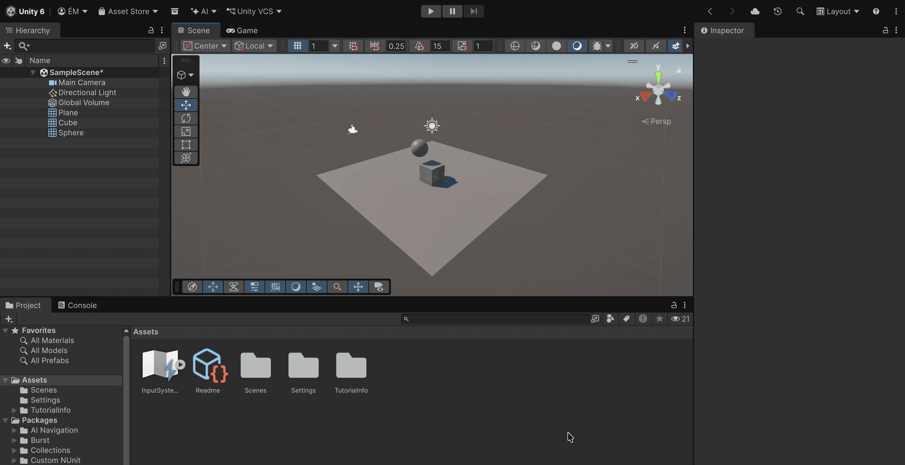

### Situación 2
El plano no es un objeto físico, el cubo sí y la esfera también. El plano solo tiene `Collider`, mientras que el cubo y la esfera tienen `Rigidbody`. Ambos caen por gravedad, chocan contra el plano y colisionan entre ellos antes de estabilizarse.

### Situación 3
El plano no es un objeto físico, el cubo es físico y la esfera es cinemática. El cubo cae por gravedad, mientras que la esfera, al ser `isKinematic`, permanece inmóvil en su posición inicial. La esfera actúa como un obstáculo inamovible: el cubo choca contra ella y se detiene, pero no la desplaza.

### Situación 4
El plano es un objeto físico, el cubo es físico y la esfera es física. Todos tienen `Rigidbody`, incluido el plano. Como consecuencia, el plano también cae por gravedad junto con el cubo y la esfera, lo que demuestra que un suelo con `Rigidbody` dinámico deja de comportarse como tal.

### Situación 5
El plano es cinemático, el cubo es físico y la esfera es física con 10 veces más masa que el cubo. La esfera, al tener más masa, desplaza al cubo con facilidad al colisionar, mientras el plano permanece fijo como suelo.

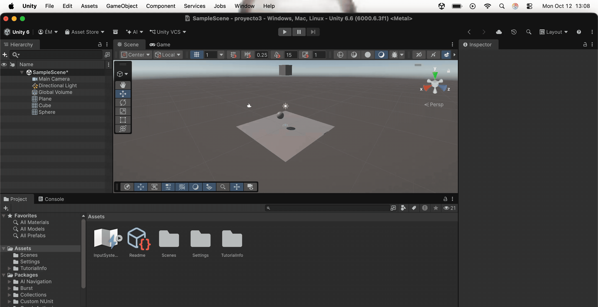

### Situación 6
El plano es cinemático, el cubo es físico y la esfera es física con 100 veces más masa que el cubo. La esfera aplasta y desplaza al cubo de forma mucho más contundente que en la situación anterior, dejando claro el efecto de la masa en las colisiones.

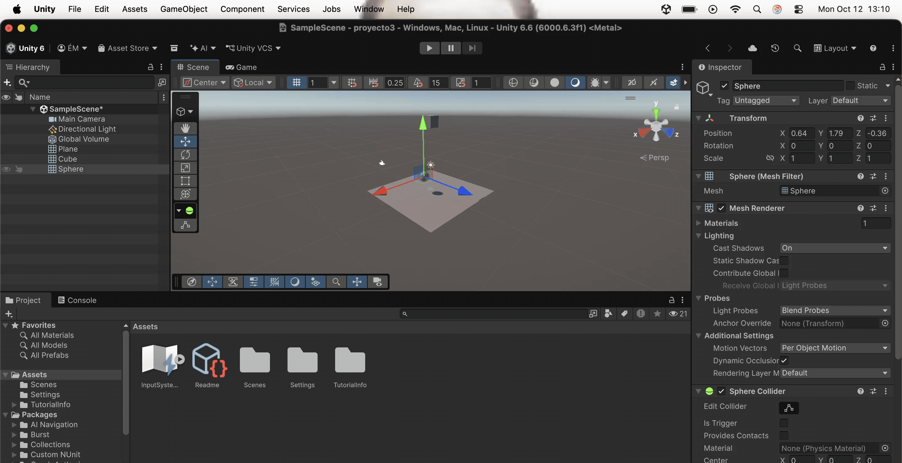

### Situación 7
El plano es físico, el cubo es físico y la esfera es física con fricción. La esfera lleva aplicado un `Physic Material` con fricción alta, por lo que al deslizarse sobre el plano o chocar contra el cubo pierde velocidad rápidamente en lugar de desplazarse libremente.

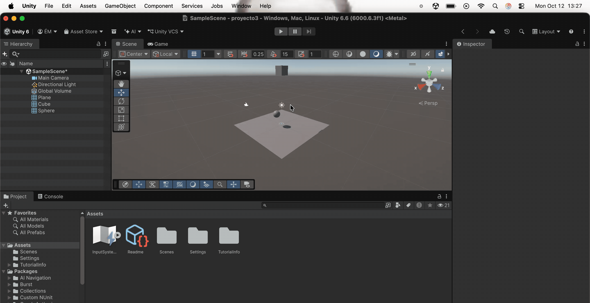

### Situación 8
El plano es cinemático, el cubo es físico y la esfera no es física pero es Trigger. La esfera tiene `Collider` con `Is Trigger`, de modo que el cubo la atraviesa sin colisionar físicamente pero se dispara `OnTriggerEnter`.

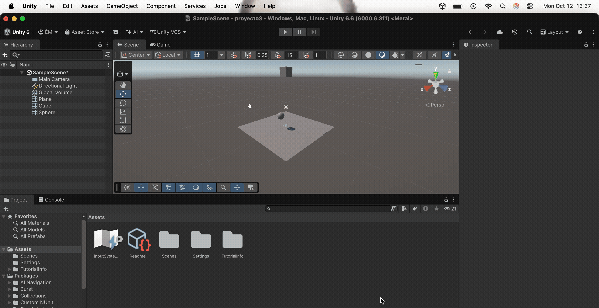

### Situación 9
El plano es cinemático, el cubo es físico y la esfera es física y Trigger. La esfera cae por gravedad y, al entrar en contacto con el cubo, no hay respuesta física de choque pero sí se dispara `OnTriggerEnter`, demostrando que un `Rigidbody` con `Collider` trigger sigue respondiendo a la gravedad.

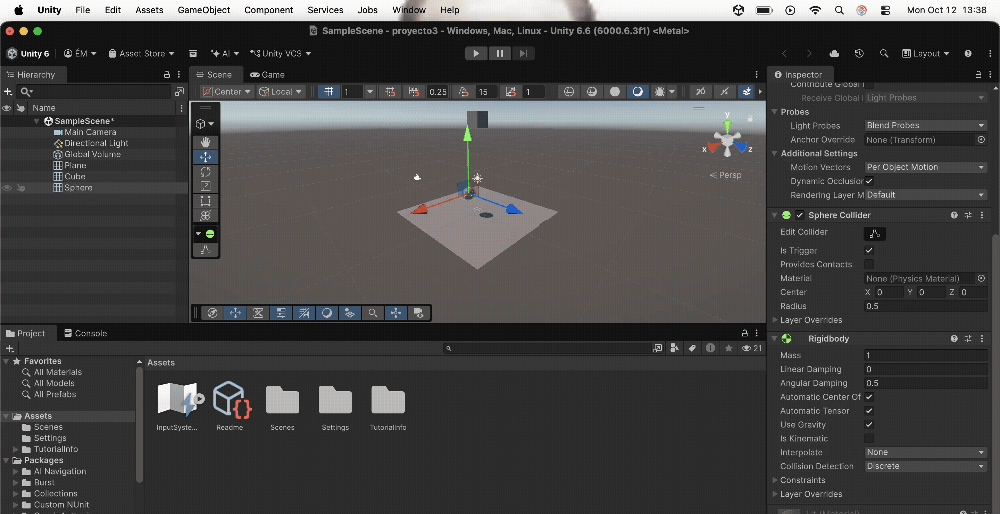

## Ejercicios

### Ejercicio 1
Se controla el desplazamiento de un personaje con las teclas WASD o las flechas. El movimiento se realiza con un `Rigidbody` configurado como `isKinematic`, de forma que el motor de física no lo mueve por su cuenta pero sí se usa `MovePosition` en `FixedUpdate` para desplazarlo, manteniendo así el control total del movimiento.

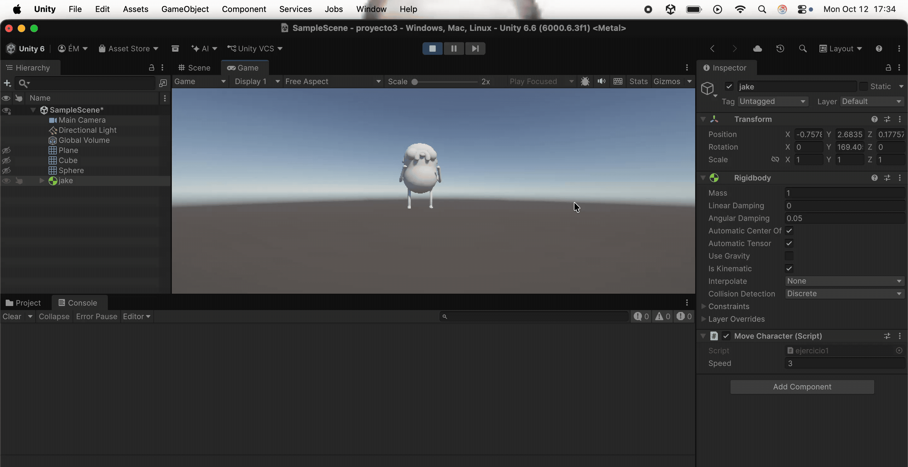

### Ejercicio 2
Se colocan varios cubos y esferas con `Rigidbody` dinámico que caen y colisionan entre sí. En cada colisión se imprime por consola el nombre del objeto con el que se ha chocado y se cambia el color del objeto a un color aleatorio mediante `Random.ColorHSV()`.

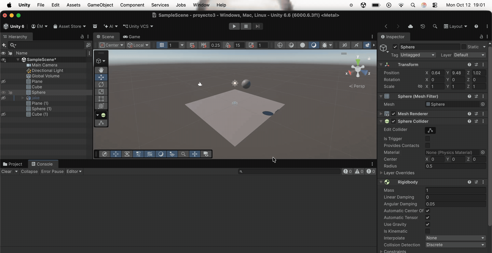

### Ejercicio 3
Se crean dos zonas con `Collider` marcado como `Is Trigger`. Una de ellas cambia el color de todos los `Renderer` del personaje al entrar (usando `GetComponentsInChildren`) y lo revierte al salir; la otra acumula un contador de daño cada vez que el personaje entra en ella.

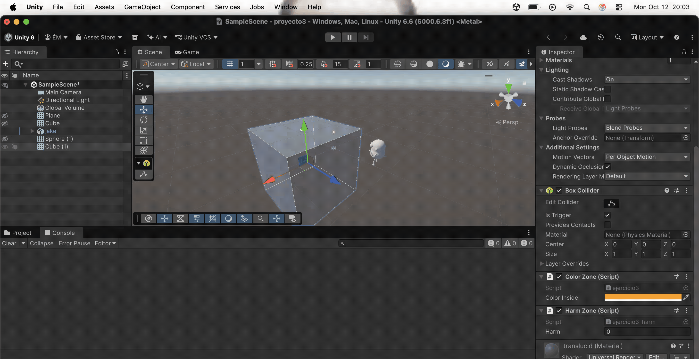

### Ejercicio 4
Se definen tres capas distintas (`Jugador`, `Enemigos`, `Recolectables`) y se configura la *Layer Collision Matrix* para que los enemigos solo colisionen con el jugador y los recolectables sean únicamente detectados por triggers (collider con `Is Trigger`), sin bloquear el paso del personaje.

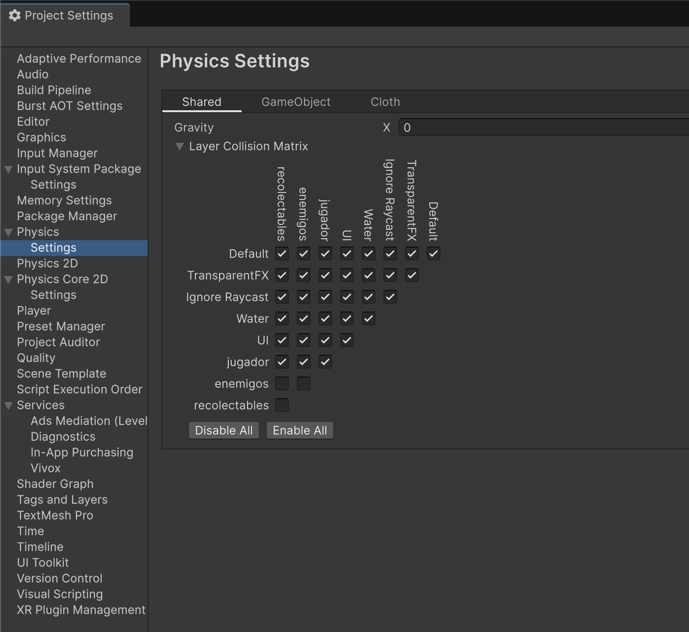

### Ejercicio 5
Se aplican distintos `Physic Material` (resbaladizo, rugoso, rebote alto) a varios objetos con `Rigidbody` dinámico. Al pulsar la tecla X se les aplica un impulso hacia arriba con `AddForce(..., ForceMode.Impulse)`, y se observa cómo la fricción y el rebote del material modifican la respuesta de cada objeto.

Con rebote
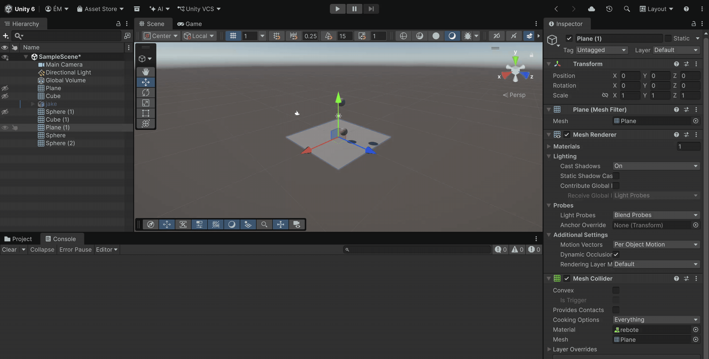

Resbaladizo
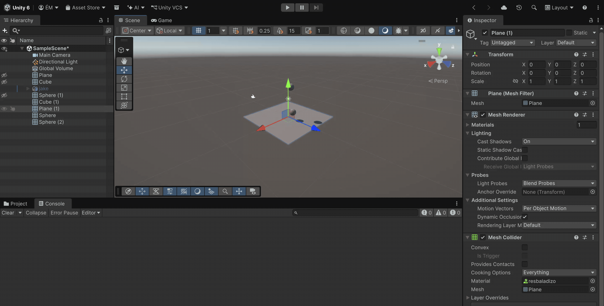

Rugoso
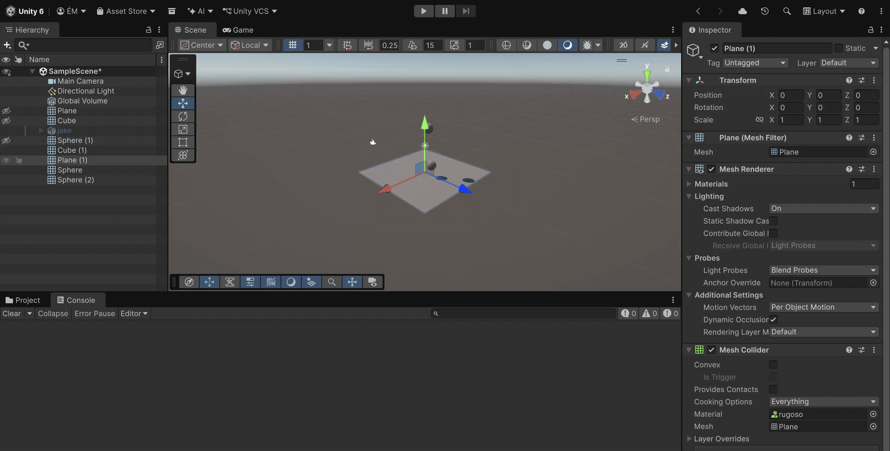

### Ejercicio 6
Se alinean tres objetos con `Collider` pero sin `Rigidbody`: un cubo entre una esfera y un cilindro. La esfera se desplaza automáticamente hacia el cilindro con `transform.position` (no tiene `Rigidbody`), y cuando su distancia al cubo es menor que un umbral configurable, el cubo cambia su material y se detiene la comprobación.

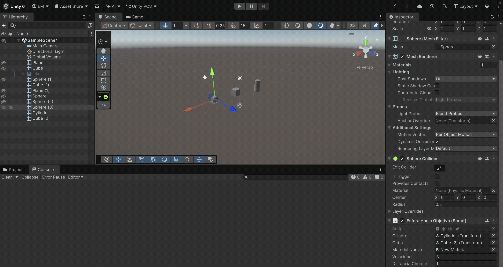